# Open Infra — GIS, NLCS and civil design for Open CAD Studio

[](https://github.com/OpenAEC-Foundation/Open-Infra/releases/latest)
[](https://github.com/HakanSeven12/OpenCADStudio)
[](https://github.com/HakanSeven12/OpenCADStudio/tree/master/crates/ocs_plugin_api)
[](https://www.nlcs.nl)
[](LICENSE)

Open, scriptable GIS and civil design inside CAD. Open Infra is a plugin for [Open CAD Studio](https://github.com/HakanSeven12/OpenCADStudio) for infrastructure and civil engineering, anywhere in the world. It is a free, open-source (GPL) alternative to commercial civil-CAD and desktop-GIS suites: GIS context and civil design in one drawing, driven from the ribbon, from scripts or by an AI agent.

**Worldwide:**

- **GIS workbench**, modelled on the FreeCAD GIS(2BIM) workbench. Set the project location anywhere in the world, in a built-in coordinate system, automatic UTM or any EPSG code. Then pull aerial photos, WMS/WFS/XYZ layers and OpenStreetMap straight into the DWG.
- **Civil design (second ribbon tab "Civiel")**, after Hakan Seven's FreeCAD Road workbench. It covers:
  - survey points and LandXML;
  - terrain (TIN, contours, height analysis);
  - alignments with stationing;
  - length profiles, design profiles and cross sections;
  - corridors with daylight, earthworks and a mass balance.
- **CityGML and CityJSON import**: 3D city models from anywhere (CityGML 1.0–3.0, CityJSON 1.x/2.0 and CityJSONSeq), reprojected to the project location and streamed object by object, so files of a whole city district load in seconds.
- **Scriptable and agent-ready**: every command takes arguments and reports back as JSON. An MCP server ([`mcp/`](mcp/README.md)) lets an AI agent build whole models.

**Plus deep Dutch integration:**

- **Dutch base data to NLCS**: BGT, cadastral map (BRK) and KLIC deliveries on NLCS layers, with object data and a finished drawing sheet. Design changes go back to the BGT as a BGT mutation (IMGeo-GML).
- **AHN heights**: spot heights, contour lines and length profiles from AHN4, and the AHN5 point cloud attached in 3D.
- **3D city and landscape model**: the AHN terrain coloured by the aerial photo, 3D BAG buildings (LoD 1.2–2.2), the whole BGT in 3D, KLIC cables and pipes in 3D under a see-through ground, and the subsurface: BRO cone penetration tests and boreholes as columns of soil layers.

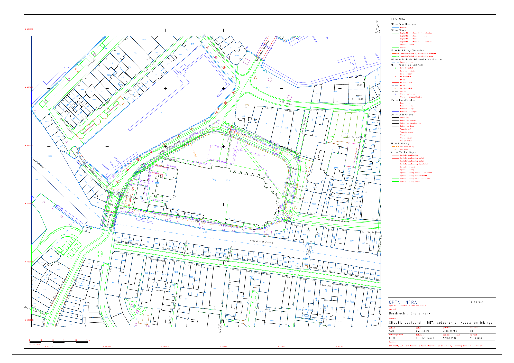

<sub>[Example drawing](examples/dordrecht-nlcs): BGT, cadastre and a KLIC delivery around the Grote Kerk in Dordrecht. A1 at 1:500, made with five commands. Available as DWG, PDF and PNG.</sub>

## At a glance

| | |
|---|---|
| **Coordinate systems** | 14 built in, automatic UTM worldwide, any EPSG code via epsg.io |
| **Service catalogue** | 600 checked public services (426 WMS, 131 WFS, 43 XYZ) in 45 countries, Europe, Africa and worldwide, searchable by place, theme and coordinate system, plus built-in presets and your own servers |
| **3D city models** | CityGML 1.0–3.0 and CityJSON 1.x/2.0 import, reprojected and filtered to the project area while reading |
| **Historical maps** | Topotijdreis (every Dutch topographic map 1815–2014) and HisGIS 1832 cadastral maps, via ArcGIS tile caches and XYZ tiles |
| **Map backgrounds** | 5: OpenStreetMap, PDOK BRT (standard and grey), PDOK aerial photo, Sentinel-2 |
| **One-click imports** | 11 OpenStreetMap themes, 11 PDOK datasets, 11 quick buttons |
| **Civil design** | survey points (PNEZD/PENZD/CSV), LandXML 1.x, TIN, alignments, length, design and cross sections, corridors with 4 assemblies, earthworks with a mass balance |
| **Automation** | arguments and JSON results for every `CIV_` command and the GIS data commands; MCP server with about 30 tools |
| **Commands** | 35 `GIS_*` commands for the ribbon, scripts and automation |
| **Code** | about 6,900 lines of Rust, 17 unit tests; Linux, Windows and macOS builds |

**Plus, for the Netherlands:**

| | |
|---|---|
| **NLCS 5.02 built in** | 3,659 objects in 32 main groups, 10 disciplines, 4 drawing statuses, 256 colours |
| **NLCS linetypes** | 543 (107 plain dash patterns, 436 with symbols or text) |
| **BGT → NLCS** | 719 rules from the official NLCS-BGT 5.0 mapping; designs go back to the BGT as IMGeo-GML 2.1.1 |
| **BGT** | 42 PDOK collections in 11 groups, current objects only |
| **KLIC** | 13 IMKL 2.0 themes: electricity (LS/MS/HS), data, gas (LD/HD), water, district heating, sewer, chemicals |
| **AHN** | AHN4 DTM/DSM at 0.5 m (PDOK WCS); AHN4/AHN5 point clouds (COPC), only the octree nodes of the project area are downloaded |
| **3D BAG** | every building in LoD 1.2, 1.3 or 2.2, with BAG id, year of construction and height as object data |
| **KLIC in 3D** | cables and pipes as tubes at their (assumed) depth under a see-through ground |
| **BRO subsurface** | cone penetration tests and boreholes as 3D soil columns (Robertson 2010 classification) |

## In Open CAD Studio

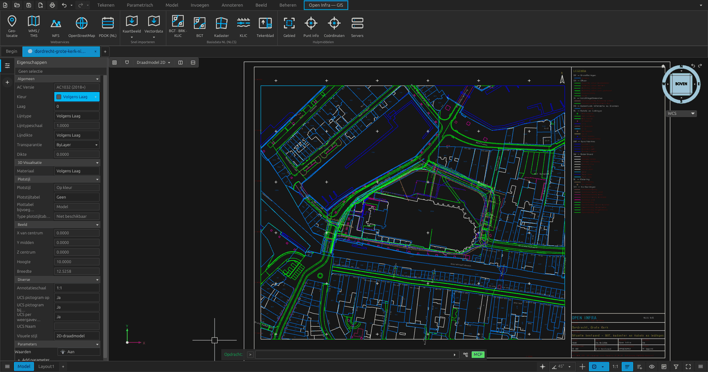

The ribbon tab **"Open Infra — GIS"**:

| Group | Button | What it does |
|---|---|---|
| Webservices | **Geo-locatie** (geolocation) | Set the project location. Click it on the map, or search an address, street, place, parcel, `lat, lon` or RD `x y`. Suggestions appear while you type (PDOK); Enter also searches worldwide (Nominatim). Each hit shows its kind, name and place; use the arrow keys and Enter to pick. Choose the coordinate system, draw or type the bounding box, and choose absolute or relative coordinates. Optionally place a base-point marker and import an aerial photo. The location is stored in the drawing (NOD XRecord `OPENINFRA/SITE`). |
| | **WMS / TMS** | Choose a server and browse its layers. **Test** shows a preview on the map; **OK en importeren** (OK and import) places IMAGE underlays behind the drawing. |
| | **WFS** | Choose a server and feature type. **Test** draws the objects on the map. Then set the label attribute, colour and clipping. |
| | **Services wereldwijd** | The service browser: search every known WMS, WFS and tile service in the world, see what covers the place on the map, and load a layer (see below). |
| | **OpenStreetMap** | Worldwide themes: buildings, roads, rail, water, civil structures, land use, cables and pipelines, fences, house numbers. |
| | **PDOK (NL)** | Several Dutch base registers in one go: aerial photo, cadastral map, AHN, BAG, parcels, NWB road sections and hectometre markers, ProRail tracks and kilometre markers, waterways. |
| Snel importeren (quick import) | **Kaartbeeld ▾ / Vectordata ▾** (map image / vector data) | One click, no window, using the saved location. |
| Basisdata NL (NLCS) (Dutch base data) | **BGT · BRK · KLIC** | The NLCS page of the workbench (see below). |
| | **BGT** · **Kadaster** | One click: the current BGT, or cadastral boundaries and parcel numbers, on NLCS layers. |
| | **KLIC** | Open a KLIC delivery: the Kadaster zip or `GI_gebiedsinformatielevering_*.xml`. It is shown on the map, then drawn. |
| | **Tekenblad** (drawing sheet) | NLCS drawing sheet around the import area: frame, title block, legend of the layers used, north arrow, scale bar and RD coordinate crosses. |
| Hoogte (AHN) (height) | **AHN** | The AHN page of the workbench: options, and **Test** to show contour lines on the map. |
| | **Hoogtepunten** · **Hoogtelijnen** (spot heights · contour lines) | Spot heights in a grid, and contour lines (minor/major, labelled) from AHN4, at their true elevation. |
| | **Profiel** (profile) | Length profile along a selected polyline or picked points: ground (DTM) and optionally surface (DSM), height grid, profile band with distances and heights, and section line A–A' in plan. |
| | **Puntenwolk** (point cloud) | The AHN5 (or AHN4) point cloud of the import area, coloured by class, height or RGB. It is written as `.rcs` next to the drawing and attached; it shows in a 3D visual style. |
| Hulpmiddelen (tools) | **Gebied** (area) · **Punt info** (point info) · **Coördinaten** (coordinates) · **Servers** | Pick the import area in the drawing, read a point's coordinates, convert coordinates, and manage presets and your own WMS/WFS/XYZ servers. |

## Service browser: WMS, WFS and tiles worldwide

The page **Services wereldwijd / Services worldwide** (ribbon button in *Kaarten & data*, command `GIS_SERVICES`) searches one catalogue:
- the 19 built-in presets;
- 600 checked public services without an API key from GIS2BIM's worldwide list ([`assets/servers/world.json`](assets/servers/world.json));
- your own servers.

What it offers:
- **Search** in free text, in Dutch or English, over name, provider, country, region and theme. Theme words work in several languages: *kadaster*, *percelen*, *cadastre*, *parcels*, *Flurstücke* and *cadastro* all find cadastral services; *luchtfoto* / *aerial* / *orthophoto*, *hoogte* / *elevation* / *DEM* and *bodem* / *geology* work the same way. Place names work too, also in other languages (*Bayern*, *Vlaanderen*, *Wenen*).
- **Filter chips** for the 17 categories and for the type (WMS, WFS, XYZ tiles).
- **Op deze locatie / At this location** keeps the services whose coverage contains the centre of the workbench map, or the project location. Pan and zoom the map to a place, or click it, to see what is available there. Local services come first, then national ones, then worldwide ones. Open CAD Studio does not share its view with plugins, so the workbench map stands in for it.
- **Results** are grouped by country. Each shows the name, provider, type, category, coordinate systems (the request CRS first) and licence.
- **A chosen service** fetches its GetCapabilities in the background. The page then lists the layers or feature types, each with its WGS 84 extent and its coordinate systems, and says whether the location lies inside. The map shows the service's coverage (orange) and the layer's extent (green).
- **Coordinate systems side by side:** the project CRS next to the service's. Each service CRS is marked *built in*, *via epsg.io* or *cannot transform*, and a line says how the data will reach the project CRS. When none of the service's systems can be transformed, the page warns.
- **Load into the drawing** for the project area, through the same code as the WMS and WFS pages. WMS and tiles become image underlays, reprojected when the server lacks the project CRS. WFS features come with their attributes as object data. **Add to my servers** keeps a copy among your own servers. **Open on the WMS/WFS page** gives all the import options.
- **Other service (URL):** open any WMS, WFS or tile URL in the same view.

Coverage is a bounding box in WGS 84 per service. `tools/import_gis2bim_servers.py` takes the state, province or city the coverage text names (German Länder, Austrian and Australian states, Flanders, Wallonia, Brussels, UK nations, Spanish and Italian regions, cities such as Vienna, Prague, Toronto and Cape Town), otherwise the country or region. A box is coarse: it can include a strip of a neighbouring country.

For scripts and the MCP server (`gis_services`, `gis_service_load`):

```
GIS_SERVICES ZOEK="cadastral parcels" HIER ID=s1          → data.services: id, type, name, provider, country, coverage,
                                                             category, url, default_layer, crs, license, terms, bbox
GIS_SERVICES ZOEK=luchtfoto CATEGORIE=aerial TYPE=WMS LON=16.37 LAT=48.21 LIMIET=10
GIS_SERVICE_LOAD DIENST=w-de-by-ldbv-alkis-parzellarkarte-25832 [LAAG=<layer>] [RESOLUTIE=0.25] [LIMIET=5000]
```

## The Civiel tab (civil design)

A second plugin, `openaec.open-infra-civiel`, adds the ribbon tab **"Open Infra — Civiel"**. It shares the engine and the project location with the GIS tab. Everything goes on NLCS layers.

| Group | Tools | What they do |
|---|---|---|
| Punten (points) | **Punten importeren** (import points) · Punt plaatsen (place point) · Punten exporteren (export points) · LandXML | Survey points from PNEZD/PENZD/CSV files: separator, decimal comma and north/east order are detected. Points go on `OG-HOOGTEPUNT` with number, height and code. Clicked points get their ground height from the TIN or AHN. LandXML 1.x brings in points, surfaces and alignments (lines, curves, clothoid spirals). |
| Oppervlak (surface) | **TIN maken** (create TIN) · Hoogtelijnen · Hoogteanalyse (height analysis) · Grondverzet (earthworks) | A TIN (Delaunay, longest-edge filter) from points, 3D lines, contour lines or AHN, as 3D faces on `OG-TRIANGULATIE`: status **B** for existing ground, **N** for a design. Then: exact contours on the TIN; elevation bands with a legend; cut and fill between design (N) and existing (B), or against a level. |
| As (alignment) | **As maken** (create alignment) · As verschuiven (offset alignment) · Station / offset | An alignment from a polyline or from points of intersection with curve radii (*by layout*). It gets stationing `0+100` on `AM-KILOMETRERING`, tangent points BB/EB/HP on `AM-TANGENTPUNT` and radius labels. Then: offset lines; station and offset of any point. |
| Profielen (profiles) | **Lengteprofiel** (length profile) · Ontwerpprofiel (design profile) · Dwarsprofielen (cross sections) | Length profile over the TIN or AHN, with stationing, heights and an alignment band. The design profile comes from PVIs or a line drawn in the profile: parabolic vertical curves (crest and sag, with L and R), and grade labels. Cross sections along the alignment in a grid of views. |
| Corridor | **Corridor** | An assembly swept along the alignment and its design profile (or a level). Assemblies: *weg*, *fietspad*, *snelweg*, *dijk* (road, cycle path, motorway, dike); lane and shoulder widths, cross slopes, fill/cut slopes, crest and superelevation in curves (with runoff) are all adjustable. The corridor builds: daylight to the ground; a design TIN (status N); 3D feature lines (asphalt edge, shoulder, toe and crest of slope); cut and fill per section with average-end-area volumes and a mass balance (CSV); optional section views with the design. |
| 3D-model (3D model) | **3D BAG** · Terrein + luchtfoto (terrain + aerial photo) · BGT naar 3D (BGT to 3D) | See below. |

The window page **Civiel — instellingen** (settings) holds all settings, and they also apply to the ribbon buttons. Checked on a real road near Dordrecht: the corridor's average-end-area volumes and the independent TIN-to-TIN grid volume agree within 2 %.

## 3D city and landscape model

| | |
|---|---|
| **Terrein + luchtfoto** (`CIV_FOTOTERREIN`) | The AHN ground of the project area as a 3D surface in cells of 1–5 m. Each cell takes the colour of the PDOK aerial photo (8 cm), quantised to a palette, with one mesh per colour. Gaps (water, under buildings) are filled from their lowest neighbour. |
| **3D BAG** (`CIV_BAG3D`) | Every building from the [3D BAG](https://3dbag.nl) (TU Delft, CC BY 4.0) in LoD 1.2, 1.3 or 2.2, with BAG id, year of construction and height as object data. `STIJL=mooi` ("nice", the default): crisp planes, each roof in its colour on the aerial photo, walls by year of construction, monuments in stone, windows per storey and a plinth into the ground. `STIJL=maquette`: a white architectural model. `STIJL=realistisch` or `nlcs`: two plain colours, or the layer colours. |
| **Waterpeil** (water level, `CIV_WATERPEIL PEIL=<m NAP>`) | A water surface at a level over the project area: what floods, and which share of the area lies lower (AHN ground). Again with another level moves the same surface. |
| **KLIC in 3D** (`CIV_KLIC3D [<delivery>] [VERGROOT=1]`) | The cables and pipes of a KLIC delivery as 3D tubes under the AHN ground, in IMKL colours on their NLCS layers: at the depth the delivery gives, otherwise at the usual cover depth per network type (data and low voltage 0.6 m, medium voltage and gas 0.8 m, water 1.0 m, high voltage 1.2 m, gravity sewer 2.0 m). The diameter comes from the delivery where present. Ducts and cable beds are grey sleeves; appurtenances are short columns. The object data says whether the depth came from the delivery or was assumed. Without a file, the delivery imported last on the GIS tab is used. `VERGROOT=` thickens the tubes for overview pictures. |
| **Maaiveld doorzichtig** (see-through ground, `CIV_DOORZICHT [PCT=70] [ALLES] [UIT]`) | Makes every ground surface (terrain, BGT in 3D, water, TIN) transparent, so cables, pipes and soil columns can be seen beneath it from any angle. Buildings stay solid unless `ALLES` is given; `UIT` makes the ground opaque again. |
| **CityGML/JSON** (`CIV_CITYGML <file> [STIJL=]`) | A 3D city model from a file: CityGML 1.0, 2.0 or 3.0 (`.gml`, `.xml`), IMGeo/BGT GML, CityJSON 1.x/2.0 (`.city.json`) or CityJSONSeq (`.city.jsonl`). The file's coordinate system (EPSG codes, RD + NAP 7415, the German AdV names such as `ETRS89_UTM32*DE_DHHN2016_NH`) is transformed to the project location, and only objects in the project area are kept while reading. Buildings get roof and wall meshes on the NLCS building layers, in the same styles as the 3D BAG (walls by year of construction when the file has it); the highest LoD per object is used. Roads, green, water, bridges, tunnels and land use go to the NLCS layer of their BGT counterpart, relief (TIN) to the triangulation layer. 2D objects (IMGeo) are made 3D like `CIV_BGT3D`: draped on the AHN, water at its level, buildings extruded. Tested with the NRW LoD2 tiles (Cologne, 56–97 MB, 1,600–4,500 buildings in 1–2 s) and 3D BAG CityJSON. |
| **BGT naar 3D** (`CIV_BGT3D`) | The whole BGT of the project area in 3D, on its NLCS layers. Areas are draped on the ground: the edges every 3 m, a grid inside, and holes respected. Buildings and walls are extruded to the AHN surface, water lies at its level, bridges at deck height, lines are draped, and posts and trees become 3D symbols (trees with a round crown). Colours are natural by default (asphalt, paving, grass, water…); `KLEUR=nlcs` uses the layer colours. |

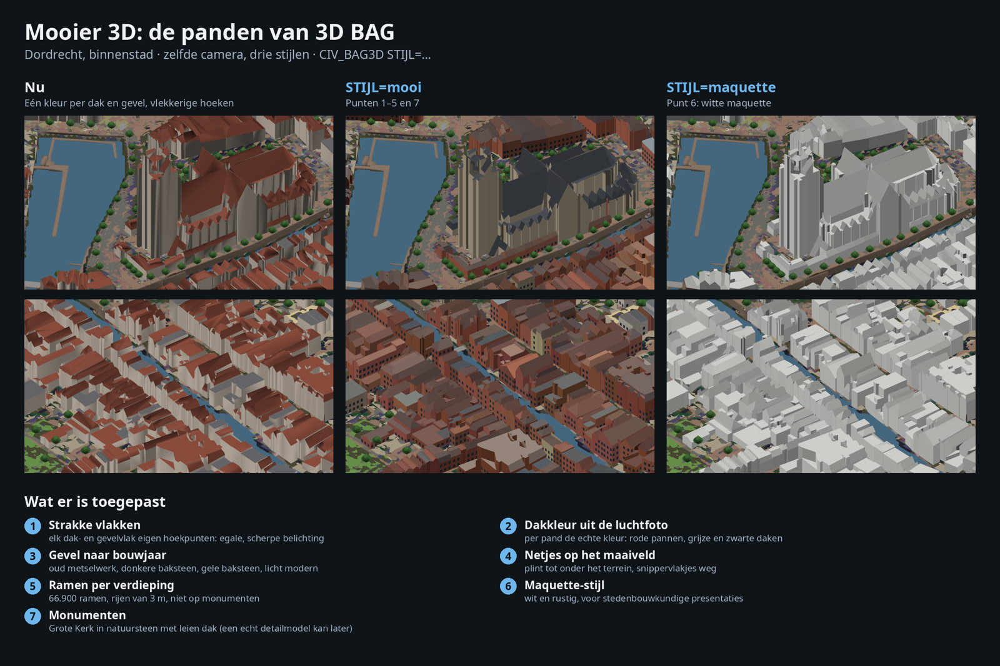

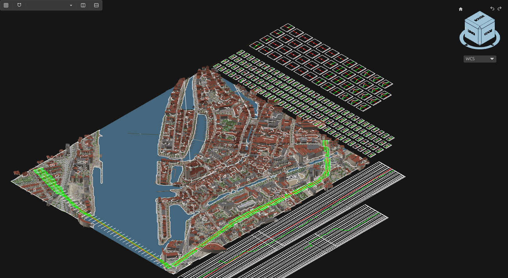

| The Grote Kerk (3D BAG LoD 2.2) and the harbours | Ring road corridor with its cross sections |
|---|---|
| 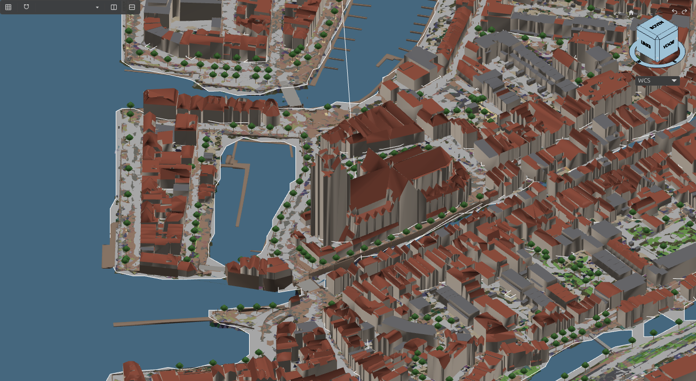 | 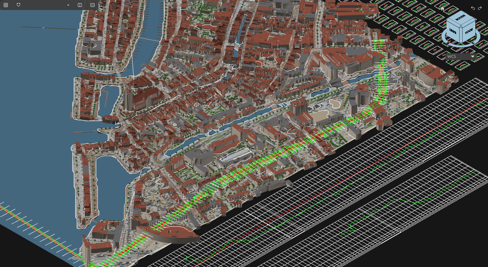 |

Dordrecht city centre (1.2 × 1.0 km), built by an agent through the MCP server (`tests/e2e/mcp_model.py`, 20 steps in about 110 s):
- 299,000 photo-coloured terrain cells;
- 18,560 BGT objects (about 480,000 triangles);
- 2,864 buildings in LoD 2.2 (204,000 triangles);
- a 1.2 km ring road and a 0.9 km dike as corridors, with 178 cross sections. Their earthworks from the sections and from the design TIN against the existing ground agree within 1 %.

**Large drawings:**
- Open CAD Studio sends a plugin at most 64 MB per message, and shares a document view of 16 MB by default.
- Open Infra sends entities in batches under that limit and draws 3D objects as light MESH entities.
- It keeps an object index in the drawing (`OPENINFRA/INDEX`: terrains, alignments, profiles, corridors, survey points), so the civil commands fetch what they need by handle at any drawing size.
- Whole-drawing tools (NLCS check, quantities) need the shared view. For drawings over 16 MB, start Open CAD Studio with `OCS_V4_SNAPSHOT_SEGMENT_SIZE=268435456` (256 MB; larger values exceed the 1 GiB the plugin side maps).

## Subsurface: CPTs and boreholes from the BRO

The BRO (Basisregistratie Ondergrond, the successor of DINOloket) holds the Dutch cone penetration tests and borehole descriptions as open data (CC0). Open Infra reads them from the public REST services at `publiek.broservices.nl`:
- **CPT** (`sr/cpt/v1`): cone resistance qc, local friction fs and friction ratio Rf per depth, the surface level in m NAP and the end depth.
- **BHR-GT** (`sr/bhrgt/v2`): geotechnical boreholes, with the soil layers described by NEN-EN-ISO 14688 (or NEN 5104 for archive data).

| | |
|---|---|
| **Sonderingen 3D** (`CIV_SONDERINGEN3D`, Civiel → 3D-model) | Every CPT and borehole in the project area becomes a vertical column from its surface level (m NAP) down: 12 sides for a CPT, 8 for a borehole, radius 0.4 m. Each soil layer is its own mesh in a conventional colour: sand yellow, silty sand pale yellow, silt/loam grey-green, clay green, peat brown, gravel orange, made ground grey. Beside each CPT, qc (red, east, 0.1 m per MPa) and Rf (blue, west, 0.25 m per %) are drawn as 3D lines. A plan symbol with the BRO id, surface level and end depth goes with each column. |
| **Sonderingen en boringen (BRO)** (`GIS_Q_SONDERINGEN`, GIS → BGT · BRK · KLIC) | Only the plan symbols and labels, without fetching the measurements: a quick overview of what has been tested. |

- **Soil type from a CPT:** each sample is classified with Robertson's (2010) soil behaviour type index, Isbt = √((3.47 − log₁₀(qc/pa))² + (log₁₀ Rf + 1.22)²), with pa = 0.1 MPa:

  | Isbt | SBT zone | Soil |
  |---|---|---|
  | > 3.60 | 2 | peat / organic soil |
  | 2.95–3.60 | 3 | clay |
  | 2.60–2.95 | 4 | silt mixtures (silt/loam) |
  | 2.05–2.60 | 5 | sand mixtures (silty sand) |
  | 1.31–2.05 | 6 | sand |
  | < 1.31 | 7 | gravelly to dense sand |

  Consecutive samples of the same class form one layer. Layers thinner than 0.2 m (`MINLAAG=`) join their thicker neighbour. Gaps without measurements (a predrilled top, missing data) stay as layers "onbekend".
- **Boreholes:** the described soil name decides the class by its main noun. For example `zwakSiltigZand` is sand, `kleiigZand` silty sand, `zwakZandigeKleiMetGrind` clay, `mineraalarmVeen` peat. Made ground (`puin`, `beton`…) is grey.
- **Object data:** every layer carries the BRO id, date, surface level (m NAP), end depth, soil type and description, top and bottom of the layer in m NAP, and for CPTs the mean qc and Rf.
- **Layers:** NLCS `MO-ONDERZOEK_SONDERING` and `MO-ONDERZOEK_BORING`: G for the columns and graphs, S for the plan symbol, T for the labels. These are the NLCS objects for site investigation.
- **Arguments:** `BRON=sonderingen|boringen|alles`, `MAX=100` (of each kind, nearest to the centre), `STRAAL=0.4`, `MINLAAG=0.2`, `QC=nee` (no graphs), `LABELS=nee` (no plan symbols). With `ID=` the result lists every column with its layers. The MCP tool is `civ_subsurface`.
- **Large areas:** the BRO answers a search with at most 2000 objects. A larger area is split in four automatically.

## Scripting, API and MCP server

Every `CIV_` command and the GIS data commands take arguments:
- `KEY=value`;
- points `x,y` in project coordinates;
- lists separated by `;`.

With `ID=<name>` the outcome is written to `<config>/OpenCADStudio/open-infra/api/<name>.json`, as `{ok, message, data}` with handles, lengths, volumes and so on. This makes Open Infra drivable from scripts and from Open CAD Studio's REST/automation API. `CIV_HELP` and `GIS_HELP` list the arguments.

```
GIS_SITE RD 104900 425350 1200 1000 Dordrecht binnenstad ID=s1
CIV_AS PI=104350,424900;104800,424950;105300,424900 R=200 NAAM=Rondweg ID=a1     → data.as = handle
CIV_ONTWERPPROFIEL AS=<handle> PVI=0:1.5;400:3.0;800:2.0 BOOG=120
CIV_CORRIDOR AS=<handle> SJABLOON=weg RIJSTROOK=3.5 TALUD=3 DWARSPROFIELEN=ja ID=c1
```

The [MCP server](mcp/README.md) (`mcp/open_infra_mcp.py`, Python standard library only) offers about 30 tools on top of this, from `oi_site` to `civ_corridor`, `civ_bag3d` and `oi_capture`. It finds every Open CAD Studio window by itself.

## The workbench window

Every page follows the FreeCAD GIS dialogs:

1. A **map** at the top shows the project location and the bounding box.
2. Grouped settings follow.
3. A fixed action bar holds **OK en importeren**, **Test** and **Annuleren** (Cancel).

You choose the map background in a **Leaflet-style layer switcher** at the top right. Click the map to set the location; Shift+drag draws the bounding box.

| Geographic location | WMS preview (PDOK aerial photo, 8 cm) |
|---|---|
| 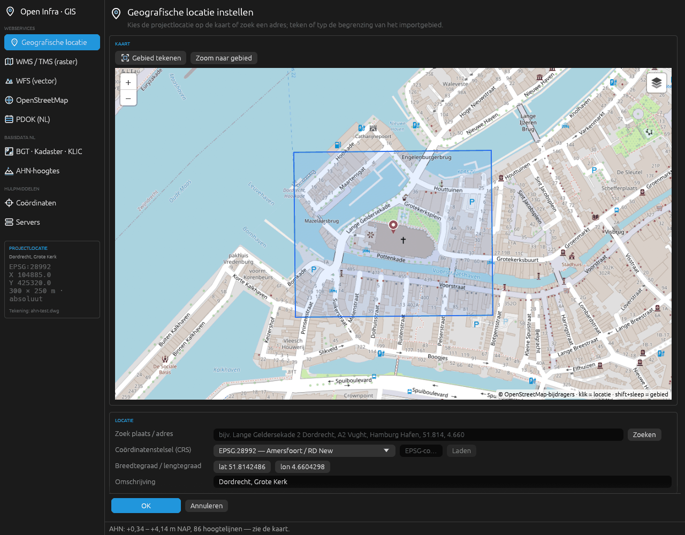 | 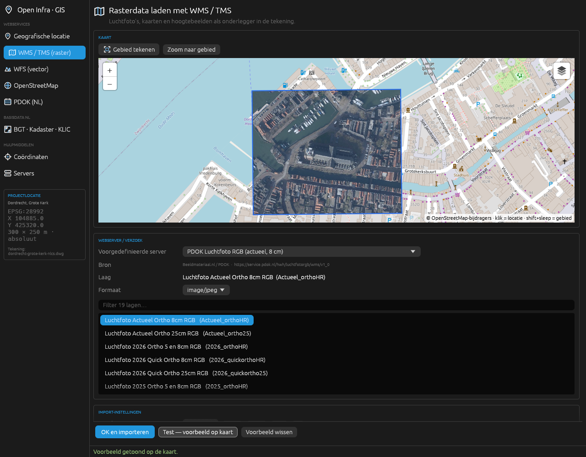 |
| **Server presets**, Netherlands, Flanders and worldwide | **BGT · Kadaster · KLIC** with the BGT preview in NLCS colours |
| 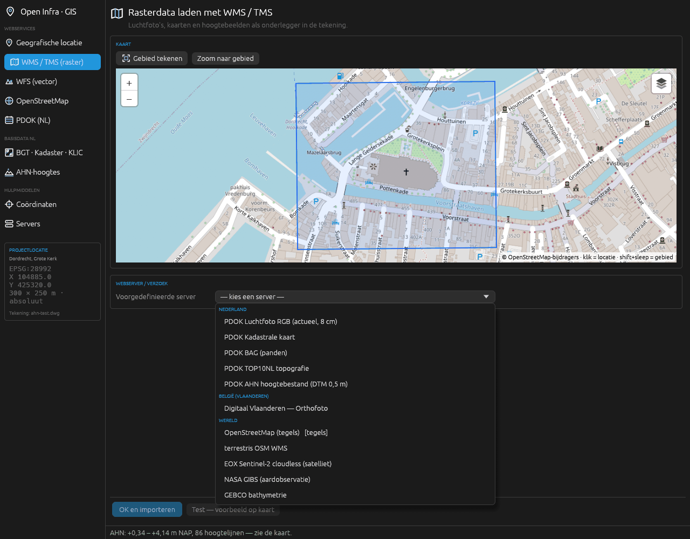 | 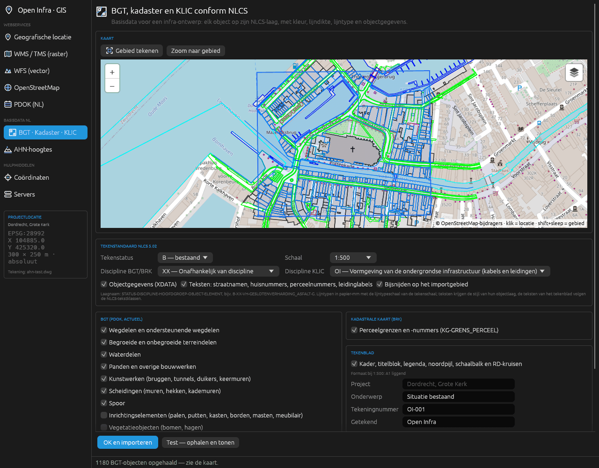 |
| **AHN-hoogtes** (AHN heights) with the contour preview (coloured by height) | **AHN5 point cloud** in Open CAD Studio (3D, by class) |
| 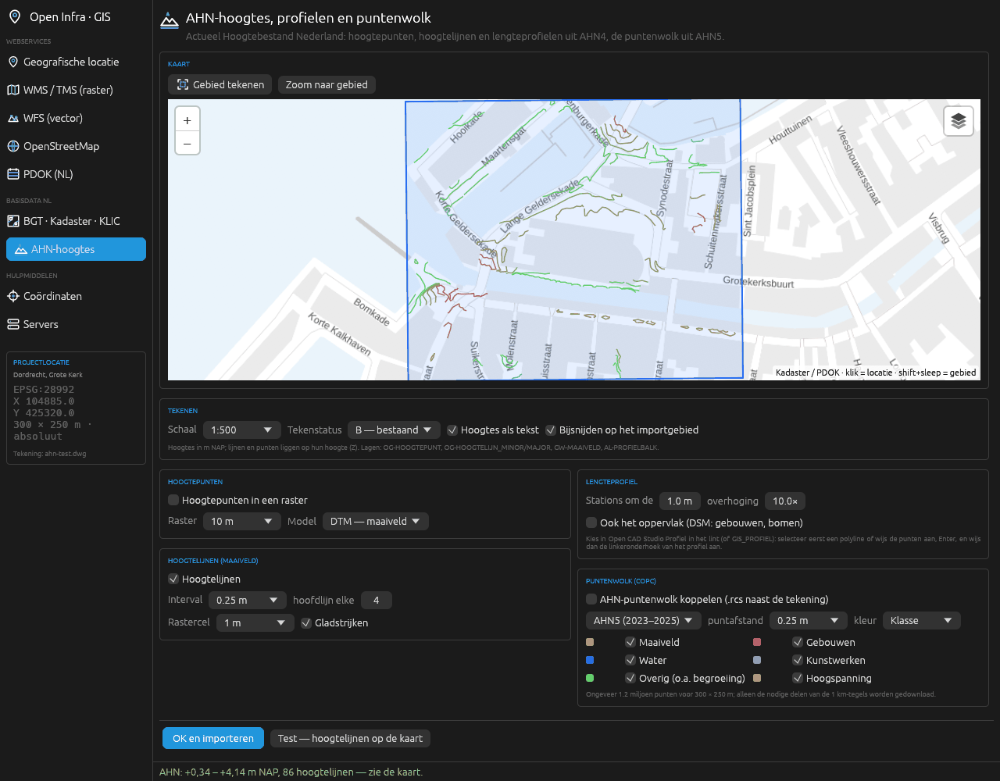 | 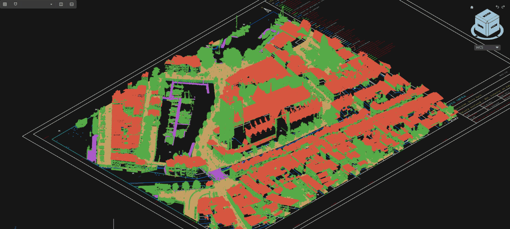 |

## Dutch base data to NLCS

The NLCS tables and the official NLCS-BGT 5.0 mapping are built in from [`assets/nlcs`](assets/nlcs): objects, colours, linetypes, statuses, disciplines and main groups. The source is DigiGO / Stichting NLCS, under CC BY 4.0. `tools/nlcs_tables.py` regenerates them from a new NLCS publication.

- **Layers:** every object goes on its NLCS layer `STATUS-DISCIPLINE-HOOFDGROEP-OBJECT-ELEMENT`, e.g. `B-XX-VH-GESLOTENVERHARDING_ASFALT-G` or `B-OI-KL-GAS_LD-G`.
  - The layer gets the NLCS colour, lineweight and linetype for the chosen drawing status (B/N/T/V).
  - Linetypes are defined in paper millimetres, and entities get the linetype scale of the plot scale.
  - Elements: G for lines and areas, S for points, T for texts.
- **BGT:** current objects from the PDOK OGC API (`eind_registratie IS NULL`). Each object is mapped to the most specific NLCS-BGT rule, using function, physical appearance and plus attributes. Street names and house numbers are placed at their BGT rotation.
- **Cadastral map (BRK):** parcel boundaries on `KG-GRENS_PERCEEL`, and parcel numbers at their BRK rotation.
- **KLIC:**
  - IMKL 2.0 deliveries are read with OpenAEC's [`klic2geo`](https://github.com/OpenAEC-Foundation/crates-warehouse).
  - Each theme goes on its KL or RI object.
  - Cables and pipes get labels such as `G-LD Stedin 160 mm PVC`, with duplicates on parallel cables left out.
  - IMKL theme colours can be used instead of the NLCS colours.
- **Object data:** each entity carries its source attributes as XDATA `OPENINFRA`, for example BGT `lokaal_id`, function and material, or the KLIC operator, diameter and material.
- **BGT mutation (`GIS_BGT_MUTATIE`):** the design on NLCS layers back to the BGT, as IMGeo-GML 2.1.1 with a report beside the drawing.
  - Layers N become plan topography (IMGeo plus-status `plan`); R (or N with `GEREALISEERD`) is as built; V ends the BGT object. BGT objects keep their `lokaal_id`; new ones get `<bronhouder>.<uuid>`.
  - The NLCS-BGT mapping is used backwards. Where a layer stands for several BGT types or functions (asphalt: the BGT classes wegdeel, ondersteunend wegdeel or onbegroeid terreindeel, i.e. road section, auxiliary road section or unvegetated terrain), the type and function come from the object data, else from the BGT object the new surface covers most. What stays ambiguous is listed in the report, not exported.
  - Checks: self-intersections, at most 5000 points, coordinates to the millimetre, ring orientation, overlaps on ground level among the mutation and with BGT objects that stay.
  - The file is valid against the IMGeo 2.1.1 schema. The bronhouder's (the responsible authority's) BGT package reads it and delivers to the LV-BGT as StUF-Geo IMGeo through BRAVO.
- **Drawing sheet:**
  - The sheet format is chosen automatically (A3–A0 landscape).
  - The title block lists the data sources of the imports.
  - The legend shows the NLCS layers used, grouped by main group.
  - Sheet texts follow the NLCS text classes (T1.8, T2.5, …).

## AHN heights, profiles and point clouds

- **Heights:** AHN4 from the PDOK WCS: DTM (ground level) and DSM (surface), 0.5 m float grids in m NAP. Larger areas are fetched in tiles or at a coarser cell size.
- **Spot heights** go on `OG-HOOGTEPUNT`, with labels such as `+2,43`. **Contour lines** go on `OG-HOOGTELIJN_MINOR/MAJOR` (marching squares on a lightly smoothed grid). Both sit at their real height (Z).
- **Length profile (`GIS_PROFIEL`):**
  - Select a polyline or line, or pick points and press Enter. Then pick the lower-left corner of the profile.
  - The profile draws the ground line on `GW-MAAIVELD`, optionally the surface line, and a height grid with NAP labels.
  - The profile band (`AL-PROFIELBALK`) lists distances and heights. The NAP line is drawn when it is in range, and the section line A–A' in plan.
  - The profile breaks where AHN has no ground level (buildings, water).
- **Point cloud (`GIS_PUNTENWOLK`):**
  - AHN5 or AHN4 is read as COPC (Cloud Optimized Point Cloud) from Het Waterschapshuis' 1 km tiles. Only the octree nodes in the import area are downloaded, at the chosen point spacing.
  - The cloud is coloured by class (ground, buildings, water, structures, other), by height or by RGB.
  - It is saved as `.rcs` next to the drawing and attached with POINTCLOUDATTACH.
  - Example: 300 × 250 m at 0.25 m spacing is about 1.4 million points and a 29 MB file.
- **Punt info** also reports the AHN ground and surface height of the picked point.

Length profile across the Grotekerksplein: the ground line breaks at the harbour water and the buildings.

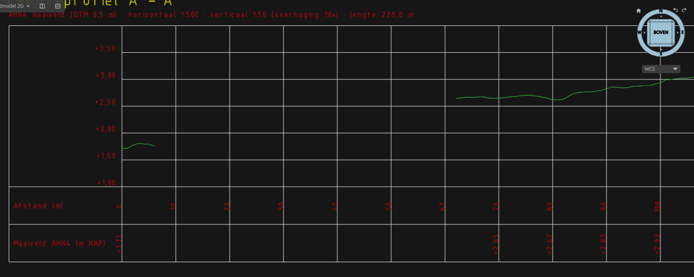

## Example drawing

[`examples/dordrecht-nlcs`](examples/dordrecht-nlcs) is the existing situation around the Grote Kerk in Dordrecht. It is 300 × 250 m in RD, on an A1 sheet at 1:500.

| | |
|---|---|
| Entities | 3,439: 1,242 BGT, 1,328 cadastre, 632 KLIC, 237 drawing sheet |
| NLCS layers | 68, with 8 NLCS linetypes |
| With object data (XDATA) | 3,202 |
| Files | DWG (0.7 MB), PDF A1 (1 MB), PNG |

| KLIC delivery around the church, labelled per operator | Legend and title block |
|---|---|
| 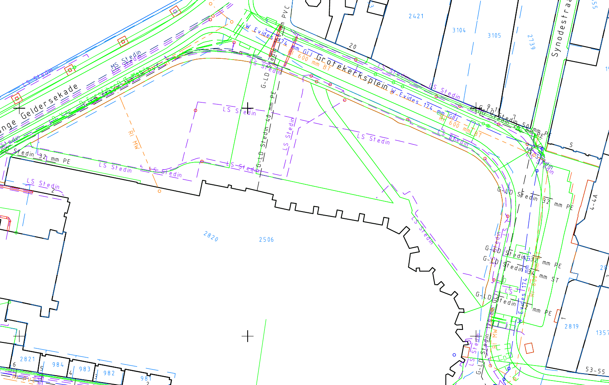 | 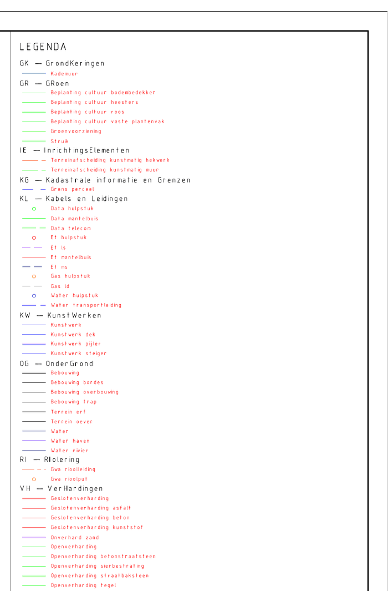 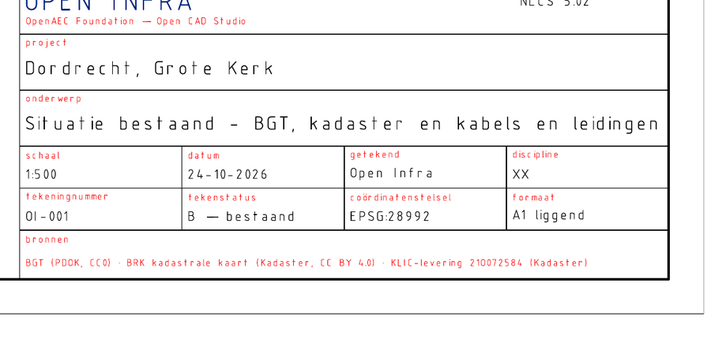 |

It was made in an empty metric drawing with:

```
GIS_SITE RD 104885 425320 300 250 Dordrecht, Grote Kerk
GIS_Q_BGT
GIS_Q_BRK
GIS_KLIC_IMPORT <path>/Levering_21O072584_1.zip
GIS_TEKENBLAD Situatie bestaand - BGT, kadaster en kabels en leidingen
```

## Commands

For the command line, scripts and automation:

| Purpose | Commands |
|---|---|
| Workbench pages | `GIS_LOCATIE`, `GIS_KAART`, `GIS_WFS`, `GIS_SERVICES`, `GIS_OSM`, `GIS_PDOK`, `GIS_BGT`, `GIS_COORD`, `GIS_SERVERS` |
| Service catalogue | `GIS_SERVICES [ZOEK=<text>] [CATEGORIE=<c>] [TYPE=WMS\|WFS\|XYZ] [HIER \| LON= LAT=] [LIMIET=50]`, `GIS_SERVICE_LOAD DIENST=<id> [LAAG=<layer>]` |
| In the drawing | `GIS_GEBIED` (pick the import area), `GIS_PUNT` (point info) |
| Location | `GIS_SITE RD <x> <y> [width] [height] [name]`, `GIS_SITE <lon> <lat> [width] [height] [EPSG:code] [name]` |
| Map images | `GIS_Q_LUCHTFOTO`, `GIS_Q_KADASTER`, `GIS_Q_AHN`, `GIS_Q_OSMKAART`, `GIS_Q_SATELLIET` |
| Vector data | `GIS_Q_BAG`, `GIS_Q_PERCELEN`, `GIS_Q_NWB`, `GIS_Q_HECTO`, `GIS_Q_SPOOR`, `GIS_Q_OSM` |
| NLCS base data | `GIS_Q_BGT`, `GIS_Q_BRK`, `GIS_Q_SONDERINGEN [BRON=]` (BRO CPTs and boreholes in plan), `GIS_KLIC [file]` (opens the page), `GIS_KLIC_IMPORT <file>`, `GIS_TEKENBLAD [subject]` |
| AHN | `GIS_AHN` (page), `GIS_HOOGTEPUNTEN`, `GIS_HOOGTELIJNEN`, `GIS_PROFIEL`, `GIS_PUNTENWOLK` |
| NLCS | `GIS_NLCS_CONTROLE`, `GIS_NLCS_RAPPORT`, `GIS_NLCS_HERSTEL`, `GIS_HOEVEELHEDEN`, `GIS_HOEVEELHEDEN_CSV`, `GIS_HOEVEELHEDEN_TABEL`, `GIS_BGT_MUTATIE [BRONHOUDER=G0505] [GEREALISEERD] [SELECTIE]` |
| Civiel tab | `CIV_PUNTEN_IMPORT`, `CIV_PUNT`, `CIV_PUNTEN_EXPORT`, `CIV_LANDXML`, `CIV_TIN`, `CIV_HOOGTELIJNEN`, `CIV_ANALYSE`, `CIV_VOLUME`, `CIV_AS`, `CIV_AS_OFFSET`, `CIV_STATION`, `CIV_LENGTEPROFIEL`, `CIV_ONTWERPPROFIEL`, `CIV_DWARSPROFIELEN`, `CIV_CORRIDOR`, `CIV_BAG3D`, `CIV_FOTOTERREIN`, `CIV_BGT3D`, `CIV_WATERPEIL`, `CIV_CITYGML`, `CIV_KLIC3D`, `CIV_DOORZICHT`, `CIV_SONDERINGEN3D`, `CIV_3DMODEL`, `CIV_INFO`, `CIV_INSTELLINGEN` |
| Help | `GIS_HELP`, `CIV_HELP` |

## Coordinate systems and units

- **Built in:**
  - RD New (EPSG:28992)
  - ETRS89 / UTM 31–33N
  - Belgian Lambert 72 and 2008
  - British National Grid
  - CH1903+ / LV95
  - Lambert-93
  - WGS 84 and Web Mercator
- **Automatic UTM** anywhere in the world.
- **Any other EPSG code** is fetched once from epsg.io and stored with the drawing.
- The address search proposes the national grid for the country it finds.
- **RD accuracy:** RD uses the 7-parameter transformation, about 0.2 m from RDNAPTRANS. That is fine for underlays and context. For survey work, use data that is already in RD; PDOK, BGT, BRK and KLIC all supply it that way.
- **Units:** `INSUNITS` sets the drawing units: metres (default for civil drawings), mm or cm.
  - **Absolute:** CRS coordinates go straight into the drawing, as is usual in Dutch infra work.
  - **Relative:** the base point becomes 0,0.
- **Map images** are saved next to the drawing in `<name>_GIS/`.

## Architecture

```
src/gis/          host-free engine: crs (proj4rs), site, servers, catalog (service search), caps (WMS/WFS GetCapabilities),
                  geocode, raster (GetMap/XYZ + reprojection), wfs, osm (Overpass), vector (GeoJSON + clipping),
                  ogcapi (OGC API Features), bgt (PDOK BGT), klic (IMKL via klic2geo),
                  ahn (WCS height grids, contours, profiles), pointcloud (COPC over HTTP, .rcs writer),
                  bro (BRO CPTs and boreholes, soil classification)
src/nlcs.rs       NLCS 5.02 tables, layer names and styles, BGT/KLIC → NLCS mapping
src/basisdata.rs  BGT, cadastre and KLIC drawn conform NLCS, with object data
src/tekenblad.rs  NLCS drawing sheet: frame, title block, legend, north arrow, scale bar
src/hoogte.rs     AHN spot heights, contour lines, length profiles and point clouds in the drawing
src/emit.rs       engine output → DWG entities (LWPOLYLINE, TEXT, CIRCLE, IMAGE)
src/bridge.rs     host requests from worker/window threads, NLCS layers and linetypes, site in the DWG
src/import.rs     import flows shared by the window and the ribbon quick buttons
src/ui/           workbench window (egui), runs in the plugin process beside the CAD window
src/lib.rs        manifest, ribbon, commands (GIS_*), click interaction (Gebied, Punt info)
src/civiel/       civil engine: landmeten (points), terrein (TIN, contours, analysis, earthwork),
                  as_profiel (alignments, profiles, sections), corridor, landxml, model3d (3D BAG,
                  photo terrain, BGT in 3D), ondergrond (BRO columns), api (arguments, JSON results)
src/gis/bag3d.rs  3D BAG client (CityJSON 2.0), rasterbestand.rs (GeoTIFF, ASC, world files, LAS/LAZ)
civiel/           the Civiel plugin: its ribbon tab and CIV_ commands, on the shared engine
mcp/              MCP server for AI agents
```

The repository is a Cargo workspace with two plugins. The GIS plugin is the root crate, with its entry points behind the default feature `plugin`. The Civiel plugin links the same crate without that feature. Build them with separate `cargo build -p …` runs; `scripts/install.sh` does both.

Open CAD Studio runs plugins out-of-process and has no dialog API for plugins, so the plugin opens its own window. Network work runs on worker threads, so the CAD window stays responsive and the plugin call timeout is never reached.

## Installing

Use Open CAD Studio's **Plugin Manager** (`PLUGINS`): choose *Add a repository*, enter `OpenAEC-Foundation/Open-Infra` and install the [latest release](https://github.com/OpenAEC-Foundation/Open-Infra/releases/latest).

Or install by hand:
1. Download `openaec.open-infra-<platform>` and `plugin.toml` from the release.
2. Put them in `<config>/OpenCADStudio/plugins/openaec.open-infra/`.
3. Restart Open CAD Studio.

Release numbers follow Open CAD Studio's calendar numbering. The current code is built for **Open CAD Studio v2026.43** (plugin API 13, opencadcodec `24b037a`, rustc 1.99.1); release 2026.44.2 was for v2026.42. The host only loads a plugin built against its own opencadcodec revision and rustc, so update the plugin together with Open CAD Studio.

## Building

```bash
./scripts/install.sh      # build both plugins and install them into ~/.config/OpenCADStudio/plugins/
cargo test --lib -p open-infra   # engine tests (CRS, clipping, NLCS, TIN, alignments, corridor, 3D BAG, …)
cargo test --test locaties                          # location test set, offline
cargo test --test locaties -- --ignored --nocapture # fetch real data at 16 locations, report in target/locatietest
python3 tests/e2e/ocs_e2e.py                        # end-to-end in Open CAD Studio: import, edit, save, reopen
```

The test set ([`tests/`](tests/README.md)) covers 16 locations: Dutch cities, a polder, the Vaalserberg, the Wadden, and cities across the border and worldwide. It also covers 30 places around the Dutch border, real BGT attributes and a KLIC delivery. It found and fixed several problems:
- the coordinate system for Antwerp and Aachen;
- search results in the wrong town;
- units of mm drawings;
- AHN5 gaps;
- one IMKL colour.

It also lists the host issues still open in Open CAD Studio.

`Cargo.toml` and `civiel/Cargo.toml` pin `ocs_plugin_api` to the Open CAD Studio v2026.43 release. For a newer Open CAD Studio, move the `rev` to the commit of that release, and update the rustc version in `.github/workflows/release.yml` to match.

For development against a local Open CAD Studio checkout, add a `.cargo/config.toml` (not committed):

```toml
[patch."https://github.com/HakanSeven12/OpenCADStudio"]
ocs_plugin_api = { path = "../OpenCADStudio/crates/ocs_plugin_api" }
```

## Platforms

- **Linux** (X11/Wayland) and **Windows**: everything works.
- **macOS**: the ribbon quick buttons and commands work. The workbench window does not yet, because winit needs the main thread there.

## Data sources and licences

- PDOK, Kadaster, Rijkswaterstaat and ProRail: open data (BGT CC0, BRK CC BY 4.0). Credit the source; the title block does this for the imports.
- AHN (Actueel Hoogtebestand Nederland): open data (CC0). Height grids come via the PDOK WCS, point clouds from Het Waterschapshuis' object storage.
- NLCS tables and the NLCS-BGT mapping: DigiGO / Stichting NLCS, CC BY 4.0 (see [`assets/nlcs/NOTICE.md`](assets/nlcs/NOTICE.md)).
- OpenStreetMap: © OpenStreetMap contributors (ODbL), via Overpass, Nominatim and the OSM tile server. Follow their usage policies (light, interactive use).
- Sentinel-2 cloudless by EOX: CC BY-NC-SA 4.0 (non-commercial).
- 3D BAG: 3D geoinformation group, TU Delft, CC BY 4.0 (api.3dbag.nl).
- Aerial photos: Beeldmateriaal.nl via PDOK, CC BY 4.0.
- BRO cone penetration tests and boreholes (Basisregistratie Ondergrond, TNO): open data (CC0), via publiek.broservices.nl.

Licence: GPL-3.0-only ([LICENSE](LICENSE)), the same as the Open CAD Studio plugin API.
