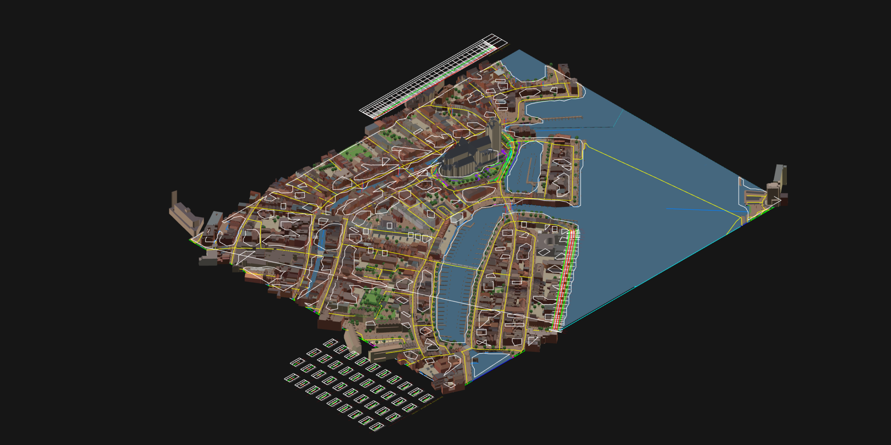
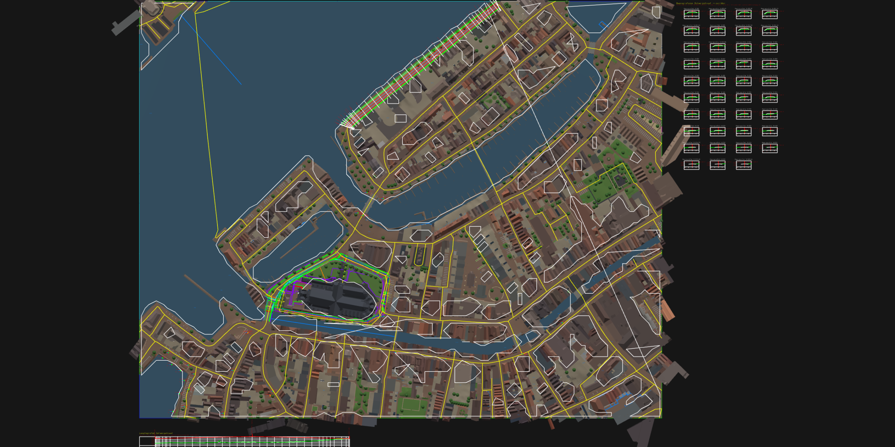
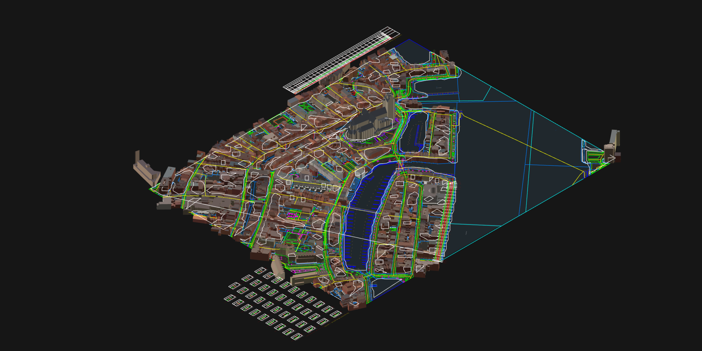
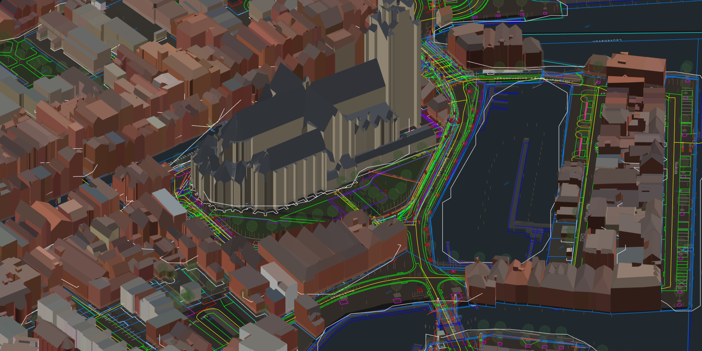

# Example: Dordrecht city centre — plan, 3D model and IFC 4.3



The city centre of Dordrecht around the Grote Kerk, 700 × 560 m. Plan and 3D model are in one drawing, and the same drawing is also available as IFC 4.3. The drawing was built with Open Infra Studio (main of 29 October 2026) in Open CAD Studio v2026.43, by the script [`bouw.py`](bouw.py). The IFC was exported with release 2026.44.5. The coordinates are RD (EPSG:28992), the heights NAP, and the units metres.

| File | What it is |
|---|---|
| [`dordrecht-3d.dwg`](dordrecht-3d.dwg) | The drawing (16 MB): the plan on NLCS layers and the 3D model. Open it in Open CAD Studio v2026.43. |
| [`dordrecht-3d.ifczip`](dordrecht-3d.ifczip) | The same drawing as IFC 4.3 (IFC4X3_ADD2), zipped: 13 MB, unzipped 64 MB. Many IFC viewers open `.ifczip` directly; otherwise unzip it to `dordrecht-3d.ifc`. |
| `dordrecht-3d-*.png` | The views below. |
| [`dordrecht-3d_corridor_ontwerpstraat.csv`](dordrecht-3d_corridor_ontwerpstraat.csv) | Cut and fill per cross section of the street design, with the mass balance. |
| [`ifc-rapport.json`](ifc-rapport.json) | What the IFC export wrote, per IFC class. |
| [`bouw.py`](bouw.py) | The script that builds it all. |

## Plan



- **BGT** (PDOK): 5,057 objects as 5,337 elements on 40 NLCS layers, with their BGT attributes as object data.
- **Cadastral map** (BRK): 4,103 parcel boundaries and 1,199 parcel numbers.
- **KLIC delivery** 21O072584: 538 cables, pipes and appurtenances of 8 network operators, on 19 NLCS layers.

## 3D model

- **BGT in 3D:** 8,372 objects.
  - Paving, green, water and structures are draped on the ground.
  - Walls are extruded, and trees and posts are 3D symbols.
  - In all: 187,794 triangles.
- **3D BAG:** 1,191 buildings in LoD 2.2, coloured by roof and year of construction.
- **KLIC in 3D:** 407 cables and pipes (7,676 m) as tubes at their usual cover depth, and 131 appurtenances and manholes as columns.
- **The subsurface from the BRO:** 25 cone penetration tests and 2 boreholes as columns of 581 soil layers.
- **Street design "Ontwerpstraat":**
  - a TIN from AHN4 (5 m grid, 13,477 triangles);
  - an axis of 260 m on a road section of the NWB;
  - a length profile and a design profile (3 PVIs, vertical curve 40 m);
  - a corridor with the *weg* template: 39 cross sections, 7 m³ cut and 1,432 m³ fill.

| Beneath a see-through ground (`CIV_DOORZICHT`) | Around the Grote Kerk |
|---|---|
|  |  |

## IFC 4.3

`CIV_IFC` writes 20,067 objects (489,690 instances), georeferenced with `IfcMapConversion` to EPSG:28992 around the base point 104980 425430:

| IFC class | Objects | From |
|---|---:|---|
| `IfcAlignment` | 1 | the design axis: 13 horizontal segments; vertical: grade, parabolic curve, grade |
| `IfcRoad` | 1 | the corridor with its feature lines |
| `IfcBuilding` | 2,392 | 3D BAG (roof and walls per building) |
| `IfcPavement`, `IfcKerb`, `IfcSurfaceFeature` | 1,447, 221, 558 | BGT paving, kerbs, road markings |
| `IfcGeographicElement` | 1,259 | terrain, green, water |
| `IfcCivilElement`, `IfcWall`, `IfcRailing` | 3,267, 283, 142 | structures, street furniture, walls, fences |
| `IfcCableSegment`, `IfcPipeSegment`, `IfcCableCarrierSegment` | 478, 130, 213 | KLIC cables, pipes and casings |
| `IfcCableFitting`, `IfcPipeFitting`, `IfcDistributionChamberElement` | 190, 42, 30 | KLIC appurtenances and manholes |
| `IfcBorehole`, `IfcGeotechnicalStratum` | 27, 581 | BRO CPTs and boreholes with their soil layers |
| `IfcAnnotation` | 7,586 | contours, parcel boundaries, labels, 2D lines |
| `IfcBuildingElementProxy` | 1,219 | other 3D objects (symbols) |

Every object carries the property sets `OpenInfra_NLCS` (layer, status, discipline, main group, object) and `OpenInfra_ObjectData` (BGT id, BAG id, BRO id, year of construction and so on).

IfcOpenShell finds no schema or EXPRESS-rule errors. The alignment's geometry, as its geometry kernel evaluates it, lies on the horizontal and vertical layout. Check it yourself:

```sh
python tests/ifc_validate.py examples/dordrecht-3d/dordrecht-3d.ifc
```

Not in the IFC: the drawing sheet and the length-profile and cross-section views. Those are drawings, not objects.

## Building it again

With the Open Infra plugins installed in Open CAD Studio and an internet connection (PDOK, 3D BAG, BRO, AHN):

```sh
python examples/dordrecht-3d/bouw.py --klic <path>/Levering_21O072584_1.zip
python examples/dordrecht-3d/bouw.py --beelden --backend vulkan   # only the views of the saved drawing
```

The script starts its own Open CAD Studio window, so other windows stay untouched. It saves the drawing and the IFC before it captures the views. The KLIC sample comes from [GIS2BIM](https://github.com/DutchSailor/GIS2BIM), at `supportfiles/Sandbox/KLIC/`.

Data:
- BGT and BAG: PDOK, CC0.
- 3D BAG: TU Delft 3D geoinformation group, CC BY 4.0.
- Kadastrale kaart and KLIC: Kadaster.
- BRO: TNO / Basisregistratie Ondergrond, CC0.
- AHN4: Het Waterschapshuis, CC0.
- NLCS 5.02: DigiGO / Stichting NLCS, CC BY 4.0.
