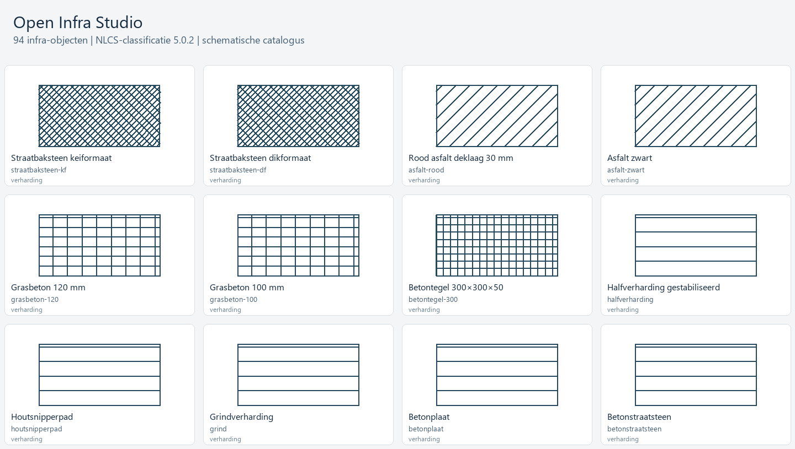

# Infra-bibliotheekvoorbeeld

- `catalogus.dwg` / `catalogus.dxf`: alle 94 parametrische catalogusonderdelen op NLCS-lagen, met opgeslagen parameters. Het overzicht is geen projectontwerp.
- `catalogus.svg` / `catalogus.png`: visueel overzicht; elk vak gebruikt een eigen passende schaal.
- `voorvertoning.png`: eerste twaalf onderdelen.
- `aansluitvoorbeeld.dwg` / `aansluitvoorbeeld.dxf`: leiding Ø75 → afsluiter → reducer Ø75/63 → leiding Ø63, plus een verhardingsvlak met aansluitende opsluitband.
- JSON-bestanden: dezelfde geometrie/parameters voor controle en reproduceerbare weergave.



Reproduceren vanaf de repositoryroot:

```text
python tools/build_infra.py
cargo run --example infra_catalogue -- examples/infra-bibliotheek
python tools/render_infra_catalog.py
```

De generator schrijft de CAD-bestanden en leest ze opnieuw in; hij controleert dat de objectparameters behouden zijn. Daarna controleert hij de herberekening van aangesloten objecten bij een lengtewijziging.

Geometrie is eigen en schematisch. Materiaalpatronen zijn eigen native arceringen, geen officiële arceerdefinities of maatvaste legplannen. Complexe NLCS-lijntypen zijn vereenvoudigd waar vormcomponenten ontbreken. NAP is alleen vastgesteld wanneer een expliciete hoogte is opgegeven. Gebruik [de bibliotheekreferentie](../../docs/infra-bibliotheek.md) voor aansluitregels en beperkingen.
